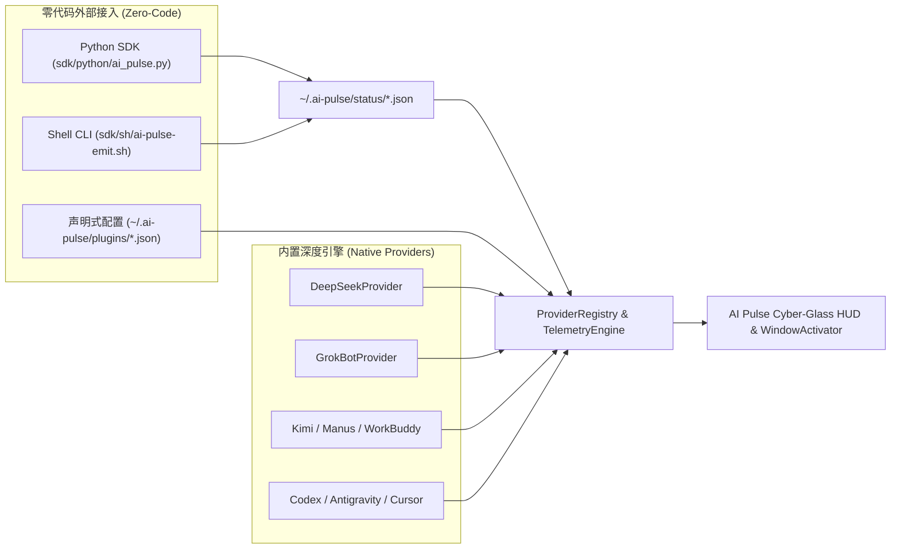

# ⚡ AI Pulse — macOS Native AI Agent & Task Radar (RADAR 2.0)

[](https://github.com/Venture-VV/ai-pulse)
[](https://swift.org)
[](./LICENSE)
[](./CONTRIBUTING.md)

> **专为多 AI 工具并行工作流打造的 macOS 原生置顶灵动岛悬浮舱 + 状态栏雷达。**  
> **A native macOS Cyber-Glass floating HUD & Dynamic Island menu bar radar for monitoring multiple concurrent AI coding agents, desktop bots, and CLI tools in real time.**

当你同时开着 **DeepSeek**、**Grok Bot**、**Kimi Code**、**Manus Studio**、**WorkBuddy**、**Antigravity**、**ChatGPT / Codex**、**Cursor**、**OpenCode** 和 **Claude Code** 跑任务时，无需再在十几个窗口和桌面 Space 之间反复切换查看进度。**AI Pulse** 每 2 秒无感扫描本机各 AI 工具的底层会话数据库（SQLite / LevelDB / JSONL）与进程状态，在任务**完成 (`已搞定`)** 或**等待人工授权 (`等你拍板`)** 时第一时间提醒你，并支持 **点击卡片一键闪现 (`↗`) 聚焦并置顶目标 AI 窗口**。

---

## ✨ 核心特性 (Key Highlights)

### 1. 🌌 2026 Cyber-Glass & 灵动岛双形态交互
- **展开监控舱 (`416×610pt`)**：采用 macOS 原生 `NSVisualEffectView(.hudWindow)` 毛玻璃材质 + 随状态变色的极光动态氛围光 (`Aurora Glow`)，跨桌面 Space 与全屏应用常驻，点击不抢占当前 IDE 输入焦点 (`nonactivatingPanel`)。
- **灵动岛迷你胶囊 (`316×50pt`)**：一键折叠为顶部灵动岛胶囊，实时展示**在线应用图标叠层 (`Avatar Stack`)**、**神经脉冲律动波形 (`NeuralWaveformView`)** 与运行计数；任务完成时胶囊内可直接点击 `闪现 ↗` 切窗。
- **macOS 状态栏常驻 (`NSStatusItem`)**：顶部菜单栏实时显示 `⚡ X 运行中` / `🟠 X 待确认` / `🎉 X 刚完成`，右键呼出快捷跳转菜单与免打扰开关。

### 2. 🔍 12+ 主流 AI 工具底层真实状态感知（非简单看 CPU）

| AI 工具 / 引擎 | 监控数据源 (Local Telemetry Source) | 精准识别能力 |
| :--- | :--- | :--- |
| **DeepSeek** (`DeepSeek Harness.app`) | `~/.dsh/storages/session_projcache/sessions/*.json` | 识别 `turnBoundary.openTurnStartSeq` 实时推理中、`userQuestions` 待确认、子 Agent 协同数、总步数与 Prompt 标题 |
| **Grok Bot** (`Grok Bot.app` + `grok` CLI) | `~/.grokbot/local-exec-daemon.json` + `sand-client-persistence/*.blob` + `~/.grok/sessions/session_search.sqlite` | 识别多 Bot 助手（如 `Jago`、`Vin` 等）最新对话、Computer-Use `inflightCount` 本机指令执行、流式输出与 `awaitingUserResponse` |
| **Kimi Code** (`Kimi Code.app` + `kimi`) | `~/.kimi-code/session_index.jsonl` + `<sessionDir>/state.json` + `server/events/session_*.jsonl` | 追踪 `turn.step.started`、`tool.call.started`、`event.session.work_changed`，自动过滤 `compaction` 等后台整理事件，短标题智能拼接上下文摘要 |
| **Manus Studio** (`Manus Studio.app`) | `~/Library/Application Support/Manus/IndexedDB/*.log` + `logs/operator.log` | 按真实字节偏移解析 Chromium V8 双字节 UTF-16LE 任务流与 `terminal run/finish` 本机终端动作 |
| **WorkBuddy** (`WorkBuddy.app`) | `~/.workbuddy/workbuddy.db` (`sessions`) + `~/.workbuddy/sessions/*.json` | 实时识别多会话任务标题、模型名、活跃 Worker 进程与 `unread` 未读完成状态 |
| **Antigravity** (`Antigravity.app`) | `~/.gemini/antigravity/brain/*/.system_generated/logs/transcript.jsonl` | 解析 `USER_INPUT`、`PLANNER_RESPONSE`、`ask_question` 待拍板与正在调用的工具名称 |
| **ChatGPT / Codex** (`ChatGPT.app` + `codex`) | `~/.codex/thread_history_1.sqlite` (`thread_turns` / `thread_items`) + `state_5.sqlite` + `rollout-*.jsonl` | 结合 `thread_turns.status == 'inProgress'` 与 JSONL 尾部事件，彻底解决长任务中途误报完成问题 |
| **Cursor** (`Cursor.app` + Cloud Agents) | `state.vscdb` (`composerHeaders` / `cloudAgentRepository`) + `conversation-search.db` | 同时监控本地 Composer 任务与云端 Background Agents |
| **OpenCode** (`OpenCode.app` + `opencode`) | `~/.local/share/opencode/opencode.db` (`session_v2` / `session_pending`) | 追踪会话更新时间戳与 `session_pending` 队列 |
| **Claude** (`Claude.app` + `claude` CLI) | `~/.claude/history.jsonl` + TTY 进程树 | 识别桌面端与终端 Claude Code 活跃任务 |
| **VS Code / Trae / CodeBuddy / Aider** | `NSWorkspace` + TTY 进程快照 | 自动识别运行中的 AI IDE 与 CLI 编码助手 |
| **自定义扩展 (`~/.ai-pulse/`)** | `~/.ai-pulse/status/*.json` + `~/.ai-pulse/plugins/*.json` | **零代码接入任何 Python / Node.js / Shell 脚本或新 AI 软件** |

---

## 🧩 开放式三层插件扩展架构 (Open Plugin Ecosystem)

为了让社区开发者能够最轻松地扩展自己的 AI 工具或本地 Bot，AI Pulse 提供了从**零代码文件写入**到**原生 Swift 协议**的三层扩展接口（详见 [`CONTRIBUTING.md`](./CONTRIBUTING.md)）：



### 30 秒接入你的 Python Agent / 脚本：

```python
from sdk.python.ai_pulse import AIPulseTask

with AIPulseTask(
    task_id="my-agent-01",
    app_name="DeepSeek",
    task_title="自动抓取并生成竞品分析报告",
    workspace="research",
    model_name="DeepSeek-R1"
) as task:
    task.update("Step 1/2 · 正在解析数据...", status="running")
    # 你的业务逻辑...
# 退出 with 块时自动标记为已搞定 (completed)，并触发 AI Pulse 提醒横幅与提示音！
```

### 一键用 Shell 命令上报状态（适合 Claude Code / Codex / Git Hooks）：

```bash
./sdk/sh/ai-pulse-emit.sh "build-job" "Grok Bot" "running" "正在执行全量回归测试" "Step 3/5 · pytest" "my-project" "grok-3"
```

---

## 🛡️ 人性化细节与五重防通知轰炸机制 (Anti-Spam Guard)

1. **五重防轰炸过滤网**：
   - 仅在拥有明确任务生命周期的引擎上触发提醒，**彻底剔除因 Electron 软件后台瞬时 CPU 抖动导致的假通知**。
   - 任务真实运行耗时必须 $\ge 6$ 秒才会在结束时提醒。
   - 基于 `completionSignature` 唯一签名去重，同一轮任务绝不重复提醒。
   - 同一软件 30 秒内最多提醒 1 次。
   - **前台焦点自动免打扰 (`👁️`)**：如果你当前正在看某个 AI 软件的窗口，它完成任务时自动静音不弹窗。
2. **全局免打扰 (`🌙`) + 实时搜索过滤 (`🔍`) + 实时读秒计时器 (`01:24`)**：
   - 支持按 `全部`、`活跃中`、`已完成`、`在线软件` 分组切换，或点击 `🔍` 搜索关键字。
   - 点击底部 `🧩 插件扩展` 按钮即可直接在 Finder 中打开 `~/.ai-pulse` 目录。

---

## 🚀 快速开始 (Quick Start)

### 环境要求
- macOS 13.0 (Ventura) 或更高版本
- Xcode Command Line Tools (`xcode-select --install`)

### 一键编译与启动

```bash
# 1. 克隆仓库
git clone https://github.com/Venture-VV/ai-pulse.git
cd ai-pulse

# 2. 编译生成原生 AI Pulse.app（零第三方依赖，纯原生 Swift + SQLite3）
./build.sh

# 3. 启动应用
open "./AI Pulse.app"
```

### 运行实机自检与自动化压力测试

```bash
# 查看当前本机检测到的所有 AI 软件与任务状态详情
"./AI Pulse.app/Contents/MacOS/AIPulse" --self-test

# 运行 4 大自动化压力测试套件（并发延迟、100任务洪峰、损坏数据容错、200帧防通知轰炸验证）
"./AI Pulse.app/Contents/MacOS/AIPulse" --stress-test
```

---

## 📄 开源协议 (License)

本项目基于 [MIT License](./LICENSE) 开源，欢迎提交 Issue 与 Pull Request 一起扩展更多 AI 工具！
